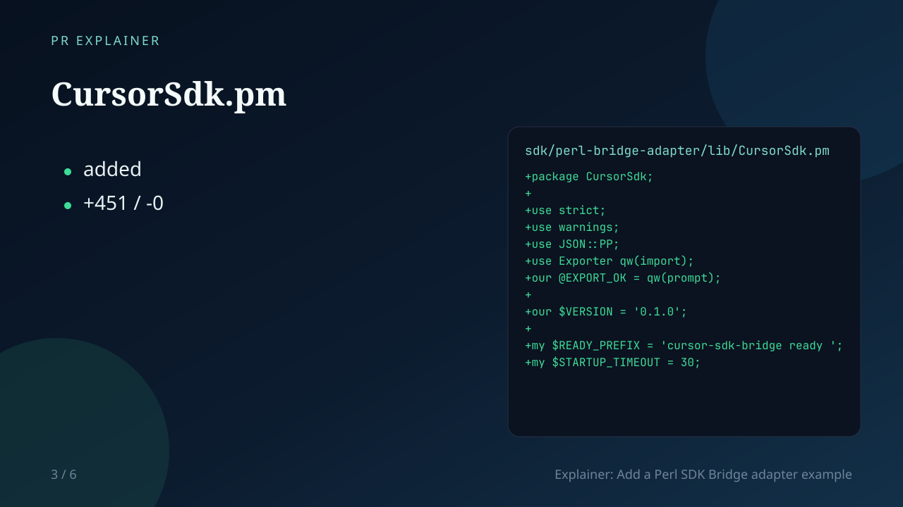

# PR Explainer Video

Turn a GitHub pull request into a short narrated explainer video. A Cursor SDK agent reads the PR (title, description, files, and diffs), writes a scene-by-scene script, then this example renders slides, synthesizes voice-over, and stitches an MP4 with ffmpeg.



Inspired by [Ben Hylak’s note](https://x.com/i/status/2107202057170288675) that a lot of pull requests will be narrated explainer videos.

## What it does

1. **Fetches the PR** from the GitHub API (public PRs work without a token).
2. **Writes an explainer script** with the Cursor SDK (`Agent.create` → `send` → stream), or a deterministic heuristic fallback via `--skip-agent`.
3. **Renders 1280×720 slide frames** (SVG → PNG) with headlines, bullets, and optional code/diff snippets.
4. **Narrates each scene** with OpenAI TTS, free Edge TTS, local `espeak`/`espeak-ng`, or timed silence plus an `.srt` caption track.
5. **Assembles `explainer.mp4`** with ffmpeg, plus `explainer.srt` and `explainer-script.json`.

## Getting Started

Use Node.js 22 or newer. Also install [ffmpeg](https://ffmpeg.org/) (`ffprobe` included). For local/free narration, install either:

- `pip install edge-tts` (recommended free cloud TTS), or
- `espeak-ng` / `espeak` (fully offline)

Install dependencies:

```bash
pnpm install
```

Set a Cursor API key:

```bash
export CURSOR_API_KEY="crsr_..."
```

Generate a video from a public PR:

```bash
pnpm dev -- https://github.com/cursor/cookbook/pull/52 --out output/demo
```

Build and run the compiled example:

```bash
pnpm build
pnpm start -- https://github.com/cursor/cookbook/pull/52 --out output/demo
```

### Without a Cursor API key

You can still exercise the slide / TTS / ffmpeg pipeline:

```bash
pnpm example
# same as:
pnpm dev -- --from-pr-file fixtures/sample-pr.json --skip-agent --out output/example
```

Or supply your own script JSON:

```bash
pnpm dev -- --from-pr-file fixtures/sample-pr.json --from-script path/to/explainer-script.json
```

## Environment

| Variable | Required | Purpose |
| --- | --- | --- |
| `CURSOR_API_KEY` | For agent script generation | Cursor SDK agent that authors the explainer |
| `CURSOR_MODEL` | No (default `composer-2`) | Model id passed to `Agent.create` |
| `OPENAI_API_KEY` | No | Prefer OpenAI TTS when set |
| `OPENAI_TTS_MODEL` | No | Default `tts-1` |
| `OPENAI_TTS_VOICE` | No | Default `alloy` |
| `EDGE_TTS_VOICE` | No | Default `en-US-JennyNeural` |
| `GITHUB_TOKEN` / `GH_TOKEN` | No | Higher GitHub API rate limits / private PRs |

### TTS backends (`--tts`)

Resolution order when `--tts` is omitted:

1. `openai` if `OPENAI_API_KEY` is set
2. `edge` if `edge-tts` or `python3 -m edge_tts` works
3. `espeak` if `espeak-ng` or `espeak` is on `PATH`
4. `silence` — timed silent audio; narration still lands in `explainer.srt`

Force one with `--tts edge`, `--tts espeak`, `--tts openai`, or `--tts silence`.

## Sample output

```text
[pr] cursor/cookbook#52 — Add a Perl SDK Bridge adapter example (5 files)
[script] --skip-agent: using heuristic script
[script] 5 scenes — Explainer: Add a Perl SDK Bridge adapter example
[slides] rendering…
[tts] using backend: edge
[tts] synthesizing narration…
[video] assembling mp4…

Done.
  video:  output/example/explainer.mp4
  subs:   output/example/explainer.srt
  tts:    edge
  script: output/example/explainer-script.json
```

Artifacts under `--out`:

```text
out/
  pr.json
  explainer-script.json
  explainer.mp4
  explainer.srt
  slides/*.png
  audio/*.mp3
  parts/*.mp4
  agent-workspace/          # only when the Cursor agent runs
```

## Notes

- Keep PRs reasonably sized; file patches are truncated before prompting so the agent stays focused on a short walkthrough.
- The heuristic `--skip-agent` path is for demos and CI without credentials — the interesting path is the Cursor SDK script.
- For a more complete terminal agent (cloud mode, TUI, model picker), see [Coding Agent CLI](../coding-agent-cli).
